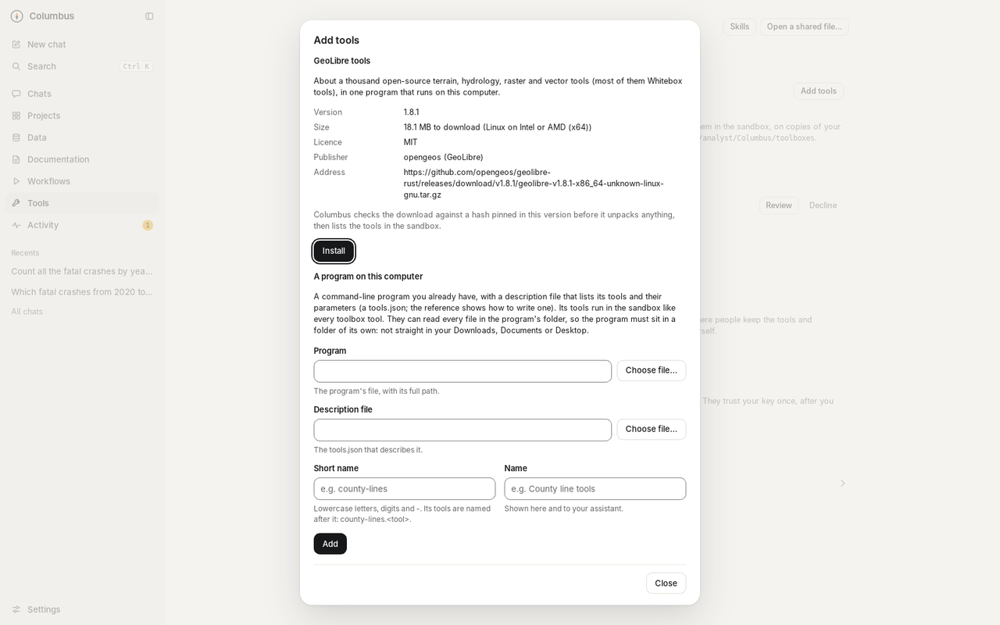
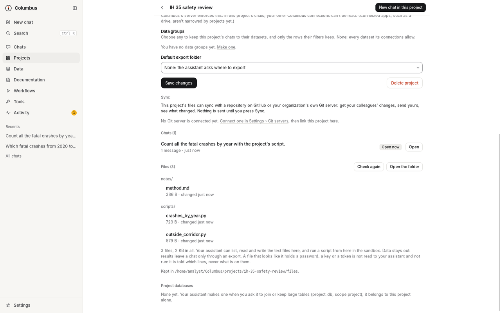

  

<h1 align="center">Columbus</h1>

  <b>Let AI work on your organization's GIS data, under your rules, on your computer.</b>

  
  
  
  

  <a href="https://github.com/wiatrek-kevin-s/columbus/releases/latest"><b>Download</b></a> ·
  <a href="#get-started"><b>Get started</b></a> ·
  <a href="docs/reference.md"><b>Docs</b></a>

  <picture>
    <source media="(prefers-color-scheme: dark)" srcset="docs/images/hero-dark.png">
    
  </picture>
   A real question about public Austin crash data, answered in the app. Each layer is checked, and the map shows what was counted.

> [!WARNING]
> **Columbus is a test release, built mostly by an AI.** Try it on data you can afford to have read, and have your organization review it before using it on production or sensitive data ([disclaimer](#disclaimer)).

## What it does

- **Reaches all your data.** Oracle and SQL Server geodatabases, file geodatabases and shapefiles, ArcGIS Online and Portal layers, CSV and Excel, GeoPackage, PostGIS and rasters. You add each one once, in the app.
- **Keeps one boundary, in code.** Your connections and passwords stay with Columbus. It reads for the AI under each source's rules (read-only unless your organization allows edits; row filters and hidden fields applied first), and what is read lands as a copy on your computer. On copies the AI works freely: once you choose **Work freely on copies**, its scripts and tools run in a sandbox with no network, without asking each time. Columbus still asks before an export to a folder that isn't pre-approved, before any edit to a source, and before code that needs the network or must leave the sandbox. Every step is logged on your computer.
- **Does real GIS work.** Queries, joins, buffers and overlays, raster analysis, your own Python and ArcGIS Pro's arcpy (experimental). Every result is checked (row counts, coordinate systems, valid shapes), and repeated jobs become scheduled workflows.
- **Uses tools you install, not ones you build.** Add GeoLibre from the Tools page: about a thousand open-source terrain, hydrology, raster and vector tools. The AI finds the right one and runs it on copies, in the same sandbox. Any other command-line program can be added with a small description file.
- **Works with the AI you choose.** The app's own chat uses Anthropic, OpenAI, xAI, Google Gemini or OpenRouter with your own key, a model on your own computer (Ollama, LM Studio), or another service you add by its address. Or keep the AI app you already use: Claude desktop, GitHub Copilot, Cursor and others can use Columbus too. The rules are the same whichever you use.

## See it work

  <picture>
    <source type="image/webp" srcset="docs/images/demo.webp">
    
  </picture>
   Ask, read, map, check. The export waits until you allow it.

## How it works

  <picture>
    <source media="(prefers-color-scheme: dark)" srcset="docs/images/how-it-works-dark.svg">
    
  </picture>

Your AI app never touches your data. It asks Columbus for each step, and Columbus decides in its own code what may be read or done. What is read lands as a copy, and scripts and installed tools get only copies, inside your operating system's sandbox. Columbus runs on your computer, with no account and no tracking. Your data goes only to the AI service you chose, and only the rows your rules allow. (AI apps reach Columbus through MCP, their standard way to use tools; the [technical reference](docs/reference.md) has the details.)

## Get started

**You need:** Windows 10 or 11, or a Mac with Apple Silicon and macOS 15 or later; Python 3.12 (the setup script installs the rest); an AI of your choice (a key for an AI service, a model on your own computer, or an AI app such as Claude desktop or GitHub Copilot); ArcGIS Pro only if you want arcpy.

1. **Download** the [latest release](https://github.com/wiatrek-kevin-s/columbus/releases/latest): the Columbus app, the Claude desktop extension and the server folder.
2. **Set up Columbus's Python** once, from the server folder: `sh engine/setup-engine.sh` on a Mac, `engine\setup-engine.ps1` on Windows. It installs the GIS tools Columbus uses.
3. **Connect an AI.** In the app, choose your AI service under **Settings › Assistant** and save its key (a model on your own computer, through Ollama, needs none). Or use an AI app you already have: install the extension in Claude desktop, or copy the entry for GitHub Copilot, Cursor and others from that same page.
4. **Add your data and ask.** In the app, **Data › Add data** (a GeoPackage or a file geodatabase is the quickest start). Then ask, for example: *Check the parcels layer for invalid geometries and show me where they are.*
5. **Choose how the AI works.** On the first-run screen or in **Settings**: **Work freely on copies** (recommended) or **Ask me before each script**. On your own computer you create Columbus's settings file once first; the guides show how.

Step by step: [Windows](docs/install.md) · [Mac](docs/install-macos.md). The app is not code-signed yet, so Windows and macOS warn the first time; the guides say what to do.

## A short tour

<table>
  <tr>
    <td width="50%"><picture><source media="(prefers-color-scheme: dark)" srcset="docs/images/tour-connections-dark.png"></picture> <b>Data.</b> What the AI may reach, in plain words.</td>
    <td width="50%"><picture><source media="(prefers-color-scheme: dark)" srcset="docs/images/tour-approval-dark.png"></picture> <b>Approvals.</b> What an export will write, and where.</td>
  </tr>
  <tr>
    <td><picture><source media="(prefers-color-scheme: dark)" srcset="docs/images/tour-workflow-run-dark.png"></picture> <b>Workflows.</b> Repeated jobs, with a report each run.</td>
    <td><picture><source media="(prefers-color-scheme: dark)" srcset="docs/images/tour-checks-dark.png"></picture> <b>How it was made.</b> Each result's checks, and what it was made from.</td>
  </tr>
  <tr>
    <td><picture><source media="(prefers-color-scheme: dark)" srcset="docs/images/tour-toolboxes-dark.png"></picture> <b>Toolboxes.</b> Tools you install instead of building.</td>
    <td><picture><source media="(prefers-color-scheme: dark)" srcset="docs/images/tour-project-dark.png"></picture> <b>Projects.</b> Files that can sync with GitHub or Gitea.</td>
  </tr>
</table>

More pages in the [app tour](docs/app-tour.md). Every picture is taken from the app by a script ([`screenshots.py`](app/desktop/e2e/screenshots.py)) on [public data](docs/images/DATA-CREDITS.md).

## What's in 0.15

- **A window like the AI apps you know:** a sidebar, the chat, and a panel on the right with the map, the table and how each result was made.
- **Work freely on copies:** one choice replaces approving each script. Exports to folders you haven't approved, edits, and code that leaves the sandbox still ask.
- **Toolboxes:** install GeoLibre, about a thousand open-source tools, from the Tools page; or add any command-line program with a small description file.
- **The map, both ways:** the AI can read what your map shows, and point it at a result.
- **Projects with files, synced with GitHub or Gitea:** each project has a folder for scripts and notes, which the AI can write and run from. Link it to a repository and press **Sync**; no Git is needed on your PC.
- **Any AI in the app's chat:** choose Anthropic, OpenAI, xAI, Google Gemini, OpenRouter or a model on your own computer (Ollama, LM Studio), or add another service by its address. The app also shows how to connect other AI apps to Columbus, with the entry to copy.

Said plainly: the GeoLibre program itself was never run while this was built, so your first install is its first real run. Sync was tested against stand-in servers, never a real GitHub or Gitea. In the app's own chat, no AI service was contacted while this was built: every one was tested against stand-ins. OpenAI, xAI, Gemini and the other services new in 0.15 were built from each one's published description, so your first chat with one of them is its first meeting with the real thing. arcpy is still *experimental*, not yet tried on a real ArcGIS Pro computer; it has to run outside the sandbox, where code could reach your connections, so Columbus asks before every such run. And 0.15 may not be published yet: if the newest version on the [releases page](https://github.com/wiatrek-kevin-s/columbus/releases) is still 0.14, it has none of the above. What changes for people coming from 0.14 is in the [release notes](packaging/release-notes.md).

## Learn more

[Technical reference](docs/reference.md) (every rule, and how it is enforced) · [What it can do](docs/capabilities.md) · [How it is built](docs/architecture.md) · [Optional manual checks](docs/manual-checks.md) · [GIS skills](skills/README.md) · [Example settings](examples) · [Security policy](SECURITY.md) · [Contributing](CONTRIBUTING.md)

## Disclaimer

Columbus is built mostly by Claude, an AI model made by Anthropic, for a GIS analyst who directs the work. Each change is checked by automated tests on macOS, Windows and Linux and by AI reviews; no professional has audited it. It comes as is, without warranty. Review it before any production use, and check what the AI produces.

## License

[Apache License 2.0](LICENSE). The sample data in the pictures is public US government data ([credits](docs/images/DATA-CREDITS.md)).
