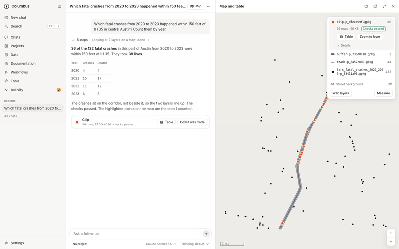

  

<h1 align="center">Columbus</h1>

  <b>Let AI work on your organization's GIS data, under your rules, on your computer.</b>

  
  
  
  

  <a href="https://github.com/wiatrek-kevin-s/columbus/releases/latest"><b>Download</b></a> ·
  <a href="#get-started"><b>Get started</b></a> ·
  <a href="docs/reference.md"><b>Docs</b></a>

  <picture>
    <source media="(prefers-color-scheme: dark)" srcset="docs/images/hero-dark.png">
    
  </picture>
   A question about real public data for Austin, Texas, answered in the Columbus app. Every layer is checked, and the map shows what was counted.

> [!WARNING]
> **Columbus is a test release, built mostly by an AI.** Try it on data you can afford to have read, and have your organization review it before using it on production or sensitive data ([disclaimer](#disclaimer)).

## What it does

- **Reaches all your data.** Oracle and SQL Server geodatabases, file geodatabases and shapefiles, ArcGIS Online and Portal layers, CSV and Excel, GeoPackage, PostGIS and rasters. You add each one once, in the app.
- **Keeps your rules, in code.** Every connection is read-only unless your organization allows edits. Row filters and hidden fields apply before the AI sees anything. Exports, edits and scripts wait for your yes, unless you approved them ahead of time (a pre-approved folder, a tool you installed). Every step is logged on your computer.
- **Does real GIS work.** Queries, joins, buffers and overlays, raster analysis, your own Python, and ArcGIS Pro's arcpy (experimental). Every result comes back with checks (row counts, coordinate systems, valid shapes), and jobs you repeat become scheduled workflows.

## See it work

  <picture>
    <source type="image/webp" srcset="docs/images/demo.webp">
    
  </picture>
   Ask, read, map, check. The export waits until you allow it.

## How it works

  <picture>
    <source media="(prefers-color-scheme: dark)" srcset="docs/images/how-it-works-dark.svg">
    
  </picture>

Your AI app never touches your data directly. It asks Columbus, through MCP (the standard way AI apps call tools), and Columbus decides in its own code what it may read and do. Columbus runs on your computer, with no account and no telemetry. Your data goes only to the AI service you chose, and only the rows your rules allow.

## Get started

1. **Download** the [latest release](https://github.com/wiatrek-kevin-s/columbus/releases/latest): the Columbus app, the Claude extension (`.mcpb`) and the server folder (`.zip`).
2. **Set up the GIS engine** once, from the server folder: `sh engine/setup-engine.sh` on a Mac, `engine\setup-engine.ps1` on Windows.
3. **Connect an AI.** Install the extension in Claude desktop, or add your Anthropic API key in the app under **Settings › Models and accounts**.
4. **Add a connection and ask.** In the app, **Connections › Add connection** (a GeoPackage or a file geodatabase is the quickest start). Then ask, for example: *Check the parcels layer for invalid geometries and show me where they are.*

Step by step: [Windows 10 and 11](docs/install.md) · [Mac](docs/install-macos.md) (Apple Silicon, macOS 15 or later). The app is not code-signed yet, so Windows and macOS warn the first time; the guides say what to do.

## A short tour

<table>
  <tr>
    <td width="50%"><picture><source media="(prefers-color-scheme: dark)" srcset="docs/images/tour-connections-dark.png"></picture> <b>Connections.</b> Each source, and in plain words what the AI may see.</td>
    <td width="50%"><picture><source media="(prefers-color-scheme: dark)" srcset="docs/images/tour-approval-dark.png"></picture> <b>Approvals.</b> An export shows exactly what it will write, and where.</td>
  </tr>
  <tr>
    <td><picture><source media="(prefers-color-scheme: dark)" srcset="docs/images/tour-workflow-run-dark.png"></picture> <b>Workflows.</b> A repeated job, run on a schedule, with a report each time.</td>
    <td><picture><source media="(prefers-color-scheme: dark)" srcset="docs/images/tour-checks-dark.png"></picture> <b>Checks and provenance.</b> Each result, what it was made from, and how.</td>
  </tr>
</table>

More pages in the [app tour](docs/app-tour.md). Every picture is taken from the app by a script ([`screenshots.py`](app/desktop/e2e/screenshots.py)) on [public data](docs/images/DATA-CREDITS.md).

## What's in 0.14

- **Folders of files:** CSV, Excel, GeoJSON, GeoParquet, KML and FlatGeobuf, with the same rules as a GeoPackage.
- **ArcGIS Online and Portal layers**, public or signed in with your organization's own ArcGIS app. The AI never sees the sign-in.
- **Your own Python environments** for scripts, sandboxed by default.
- **arcpy in trusted environments** (*experimental*: not yet checked on a real ArcGIS Pro computer).
- **File geodatabase and GeoTIFF exports**, and measures (M values) kept end to end for linear referencing.
- **Web map layers** (imagery and other services) on your map, for display only.
- **Reviewing results:** open a workflow run in a chat, zoom to a row, measure on the map.

Files and upgrade steps: [release notes](https://github.com/wiatrek-kevin-s/columbus/releases) · Everything Columbus does: [capabilities](docs/capabilities.md).

## Learn more

- [Technical reference](docs/reference.md): every rule, and how it is enforced.
- [How Columbus is built](docs/architecture.md) and [what it can do](docs/capabilities.md).
- [Install on Windows](docs/install.md) · [Install on a Mac](docs/install-macos.md) · [Optional manual checks](docs/manual-checks.md).
- [GIS skills](skills/README.md) for assistants · [example settings](examples).
- [Security policy](SECURITY.md) · [Contributing](CONTRIBUTING.md).

## Disclaimer

Columbus is built mostly by Claude, an AI model made by Anthropic, directed by its owner, a GIS analyst rather than a software engineer. Its security rests on automated tests on macOS, Windows and Linux and on AI reviews of each change, not on a professional human audit. It is offered as test releases, as is, without warranty. Don't rely on it to protect sensitive data, or use it on production systems, until your organization has reviewed it. AI assistants make mistakes: check their results, which is what Columbus's checks, approvals and provenance are for.

## License

[Apache License 2.0](LICENSE). The sample data in the pictures is public US government data ([credits](docs/images/DATA-CREDITS.md)).
