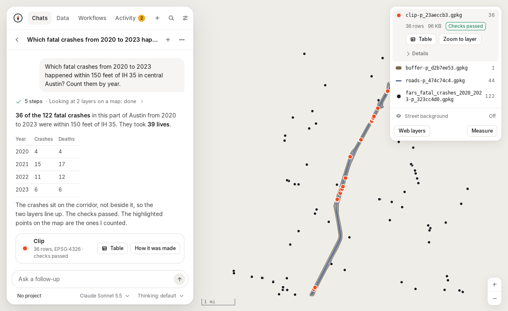
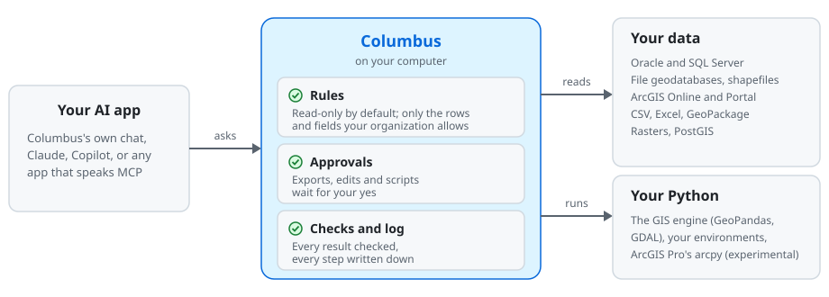
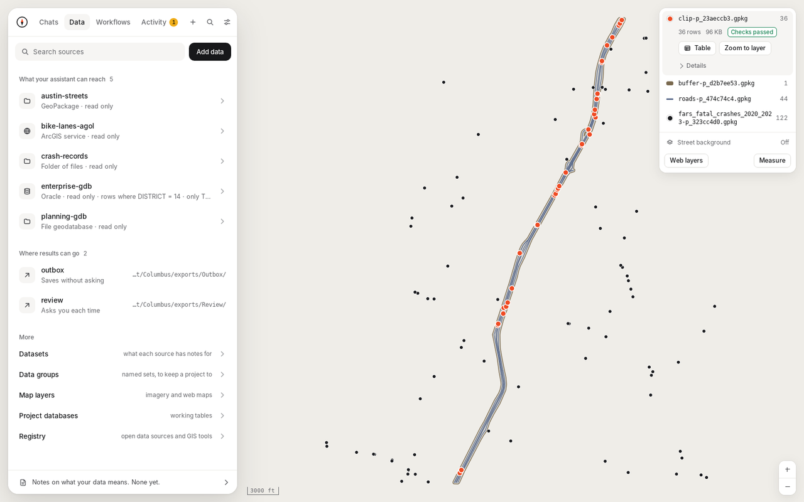
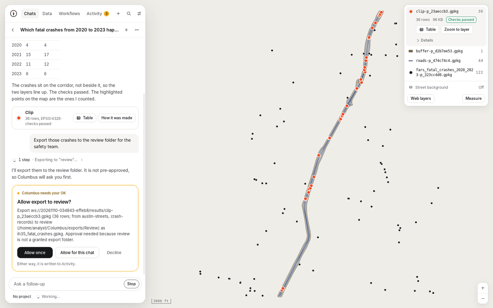
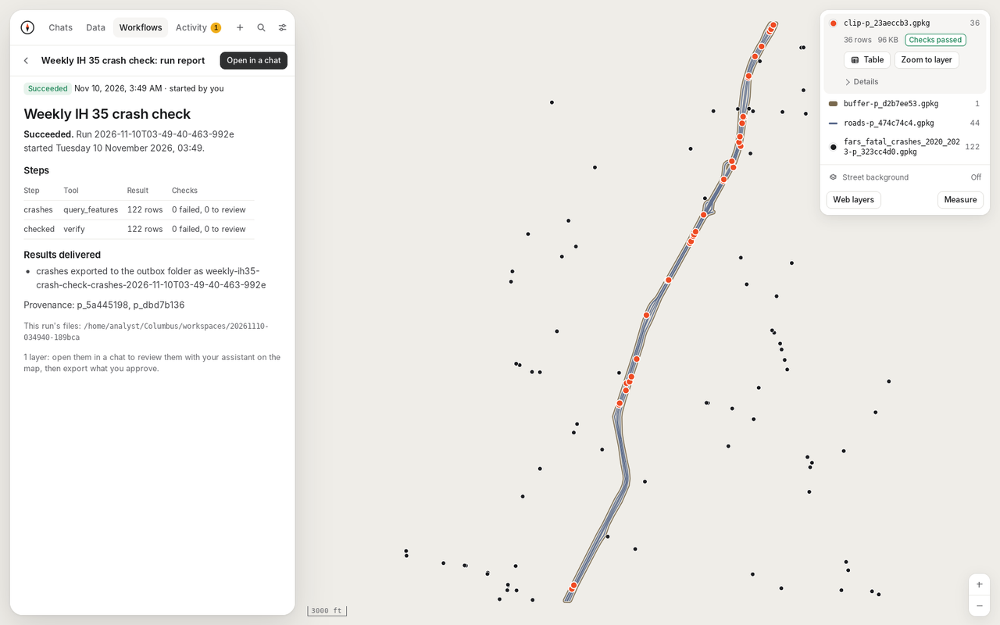
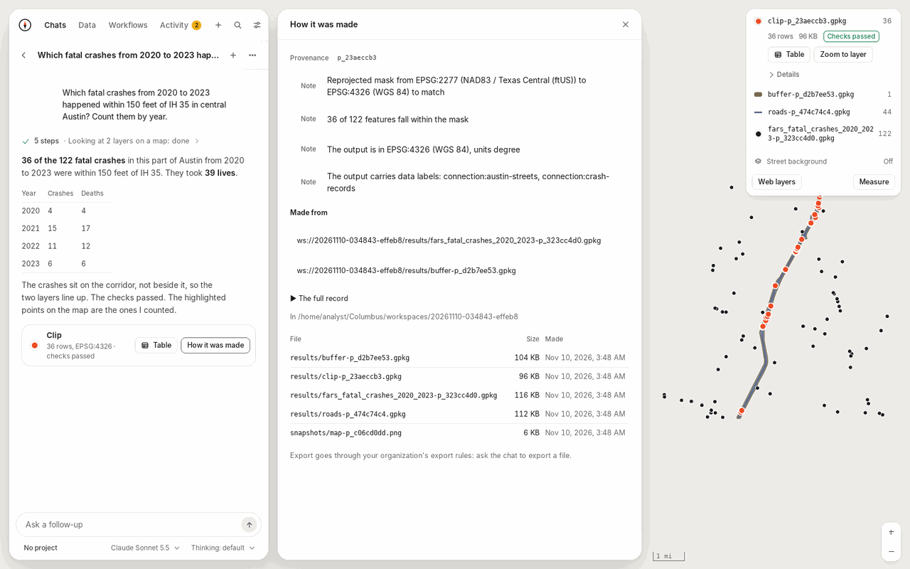

  

<h1 align="center">Columbus</h1>

  <b>Let AI work on your organization's GIS data, under your rules, on your computer.</b>

  
  
  
  

  <a href="https://github.com/wiatrek-kevin-s/columbus/releases/latest"><b>Download</b></a> ·
  <a href="#get-started"><b>Get started</b></a> ·
  <a href="docs/reference.md"><b>Docs</b></a>

  <picture>
    <source media="(prefers-color-scheme: dark)" srcset="docs/images/hero-dark.png">
    
  </picture>
   A real question about public Austin crash data, answered in the app. Each layer is checked, and the map shows what was counted.

> [!WARNING]
> **Columbus is a test release, built mostly by an AI.** Try it on data you can afford to have read, and have your organization review it before using it on production or sensitive data ([disclaimer](#disclaimer)).

## What it does

- **Reaches all your data.** Oracle and SQL Server geodatabases, file geodatabases and shapefiles, ArcGIS Online and Portal layers, CSV and Excel, GeoPackage, PostGIS and rasters. You add each one once, in the app.
- **Keeps your rules, in code.** Every connection is read-only unless your organization allows edits. Row filters and hidden fields apply before the AI sees anything. Exports, edits and scripts wait for your yes, unless you approved them ahead of time. Every step is logged on your computer.
- **Does real GIS work.** Queries, joins, buffers and overlays, raster analysis, your own Python and ArcGIS Pro's arcpy (experimental). Every result is checked (row counts, coordinate systems, valid shapes), and repeated jobs become scheduled workflows.

## See it work

  <picture>
    <source type="image/webp" srcset="docs/images/demo.webp">
    
  </picture>
   Ask, read, map, check. The export waits until you allow it.

## How it works

  <picture>
    <source media="(prefers-color-scheme: dark)" srcset="docs/images/how-it-works-dark.svg">
    
  </picture>

Your AI app never touches your data. It asks Columbus for each step, and Columbus decides in its own code what may be read or done. Columbus runs on your computer, with no account and no tracking. Your data goes only to the AI service you chose, and only the rows your rules allow. (AI apps reach Columbus through MCP, their standard way to use tools; the [technical reference](docs/reference.md) has the details.)

## Get started

**You need:** Windows 10 or 11, or a Mac with Apple Silicon and macOS 15 or later; Python 3.12 (the setup script installs the rest); Claude desktop or an Anthropic API key; ArcGIS Pro only if you want arcpy.

1. **Download** the [latest release](https://github.com/wiatrek-kevin-s/columbus/releases/latest): the Columbus app, the Claude desktop extension and the server folder.
2. **Set up Columbus's Python** once, from the server folder: `sh engine/setup-engine.sh` on a Mac, `engine\setup-engine.ps1` on Windows. It installs the GIS tools Columbus uses.
3. **Connect an AI.** Install the extension in Claude desktop, or add your Anthropic API key in the app under **Settings › Assistant**.
4. **Add your data and ask.** In the app, **Data › Add data** (a GeoPackage or a file geodatabase is the quickest start). Then ask, for example: *Check the parcels layer for invalid geometries and show me where they are.*

Step by step: [Windows](docs/install.md) · [Mac](docs/install-macos.md). The app is not code-signed yet, so Windows and macOS warn the first time; the guides say what to do.

## A short tour

<table>
  <tr>
    <td width="50%"><picture><source media="(prefers-color-scheme: dark)" srcset="docs/images/tour-connections-dark.png"></picture> <b>Data.</b> What the AI may reach, in plain words.</td>
    <td width="50%"><picture><source media="(prefers-color-scheme: dark)" srcset="docs/images/tour-approval-dark.png"></picture> <b>Approvals.</b> What an export will write, and where.</td>
  </tr>
  <tr>
    <td><picture><source media="(prefers-color-scheme: dark)" srcset="docs/images/tour-workflow-run-dark.png"></picture> <b>Workflows.</b> Repeated jobs, with a report each run.</td>
    <td><picture><source media="(prefers-color-scheme: dark)" srcset="docs/images/tour-checks-dark.png"></picture> <b>How it was made.</b> Each result's checks, and what it was made from.</td>
  </tr>
</table>

More pages in the [app tour](docs/app-tour.md). Every picture is taken from the app by a script ([`screenshots.py`](app/desktop/e2e/screenshots.py)) on [public data](docs/images/DATA-CREDITS.md).

## What's in 0.14

- **More of your data:** folders of CSV, Excel, GeoJSON and other files, and ArcGIS Online and Portal layers, under the same rules.
- **Your own Python** for scripts, and ArcGIS Pro's arcpy (*experimental*: not yet tried on a real ArcGIS Pro computer).
- **More ways to save results:** file geodatabases and GeoTIFF, with route measures kept.
- **Easier review:** imagery under your map, a workflow's last run opened in a chat, measuring on the map.

All the changes, files and upgrade steps: [release notes](https://github.com/wiatrek-kevin-s/columbus/releases).

## Learn more

[Technical reference](docs/reference.md) (every rule, and how it is enforced) · [What it can do](docs/capabilities.md) · [How it is built](docs/architecture.md) · [Optional manual checks](docs/manual-checks.md) · [GIS skills](skills/README.md) · [Example settings](examples) · [Security policy](SECURITY.md) · [Contributing](CONTRIBUTING.md)

## Disclaimer

Columbus is built mostly by Claude, an AI model made by Anthropic, for a GIS analyst who directs the work. Each change is checked by automated tests on macOS, Windows and Linux and by AI reviews; no professional has audited it. It comes as is, without warranty. Review it before any production use, and check what the AI produces.

## License

[Apache License 2.0](LICENSE). The sample data in the pictures is public US government data ([credits](docs/images/DATA-CREDITS.md)).
