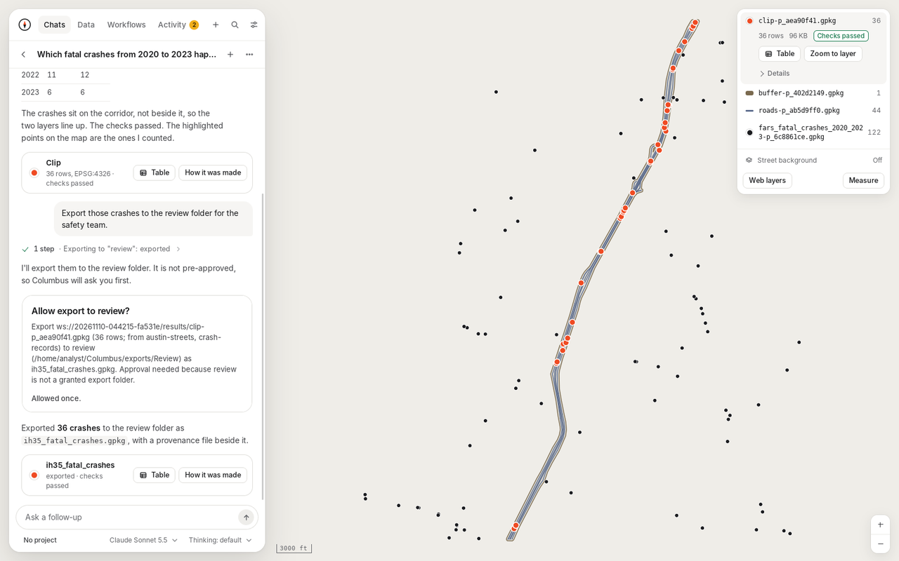
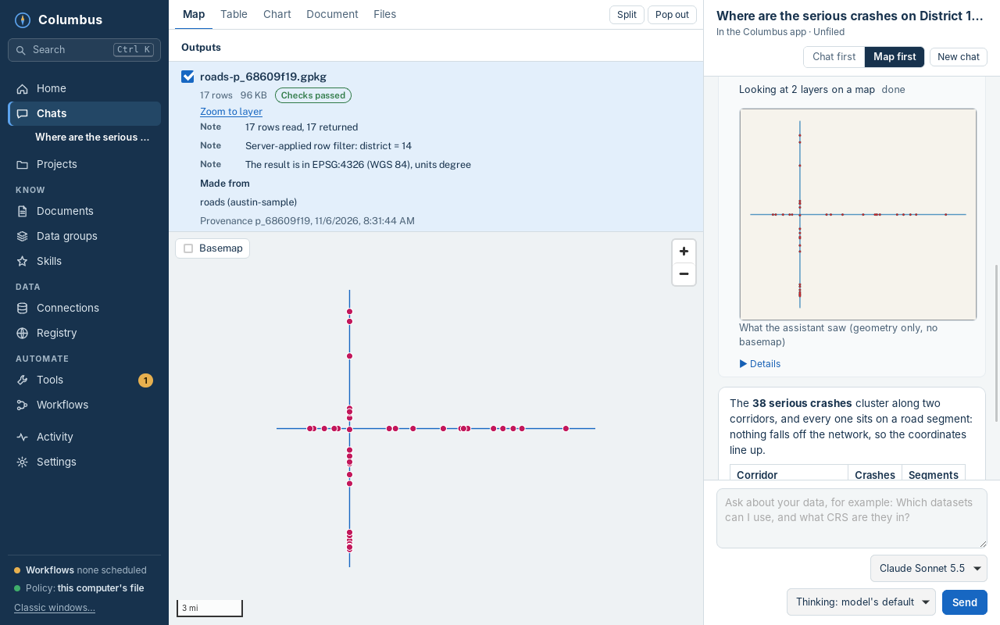
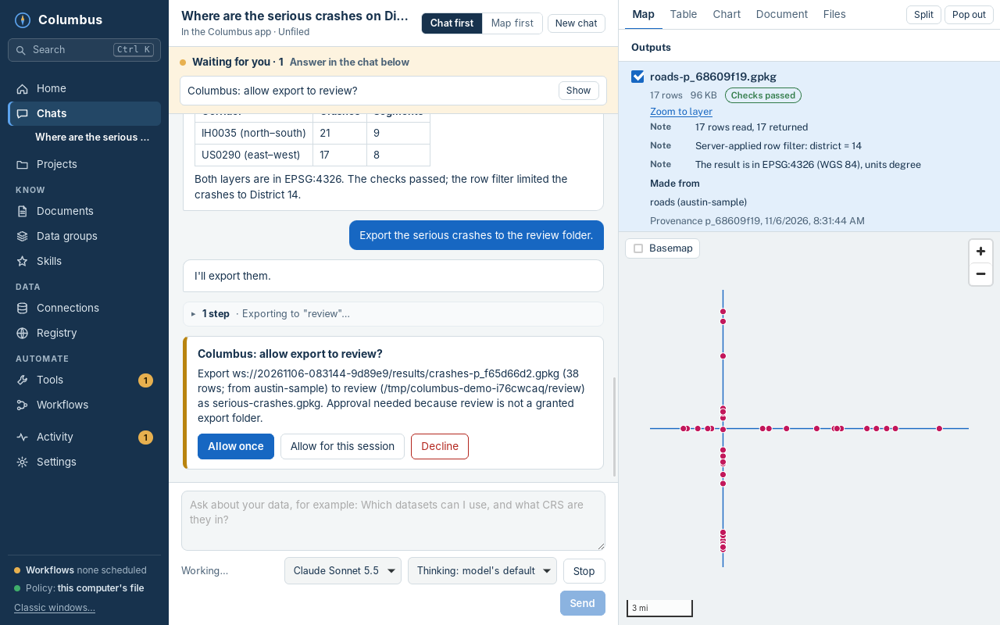
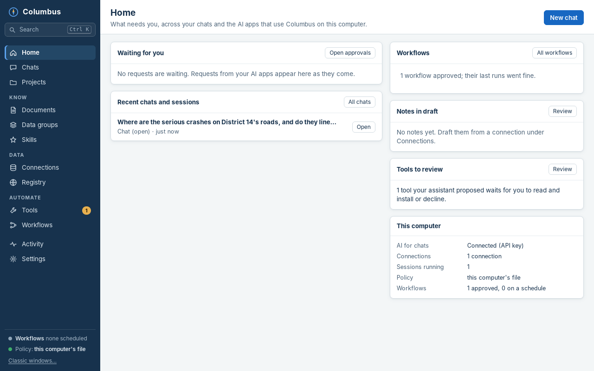
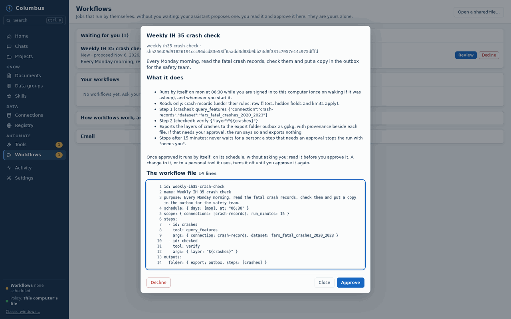
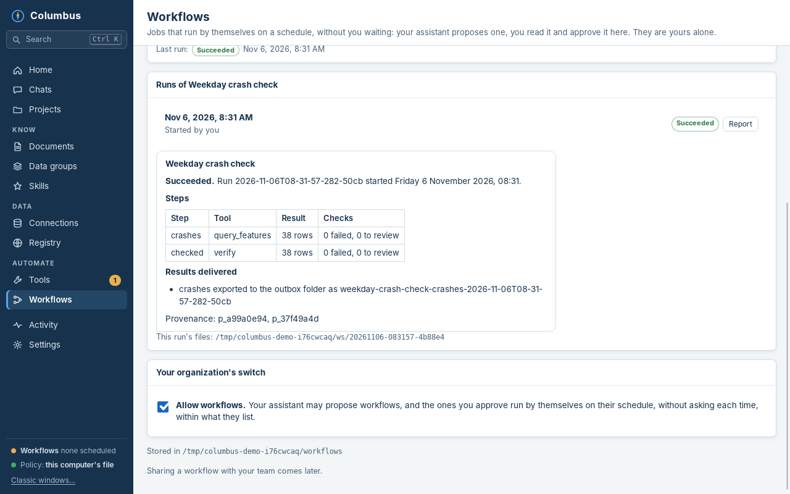
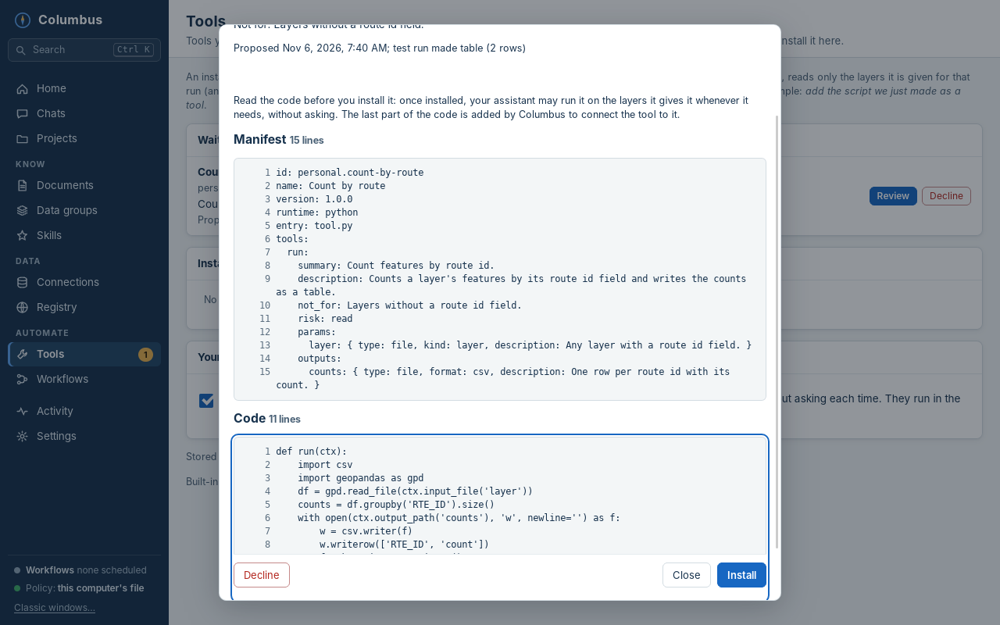
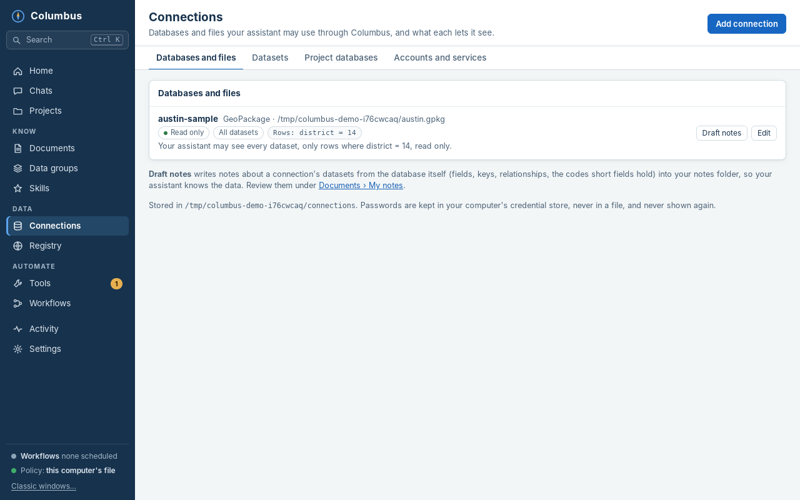
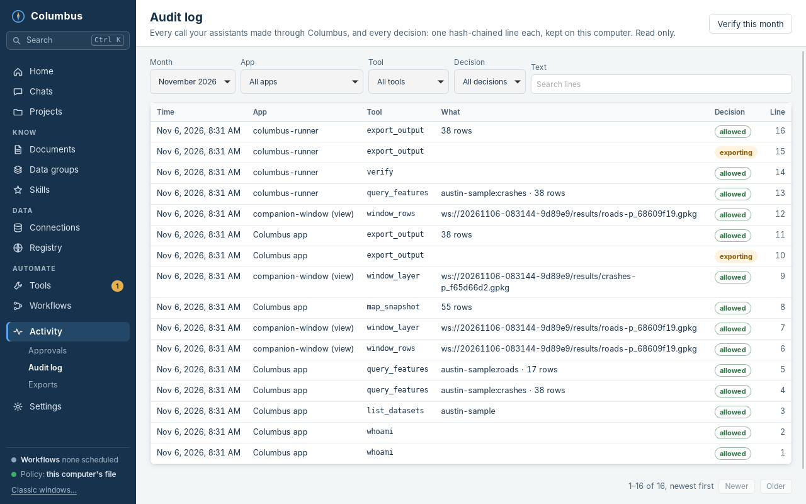
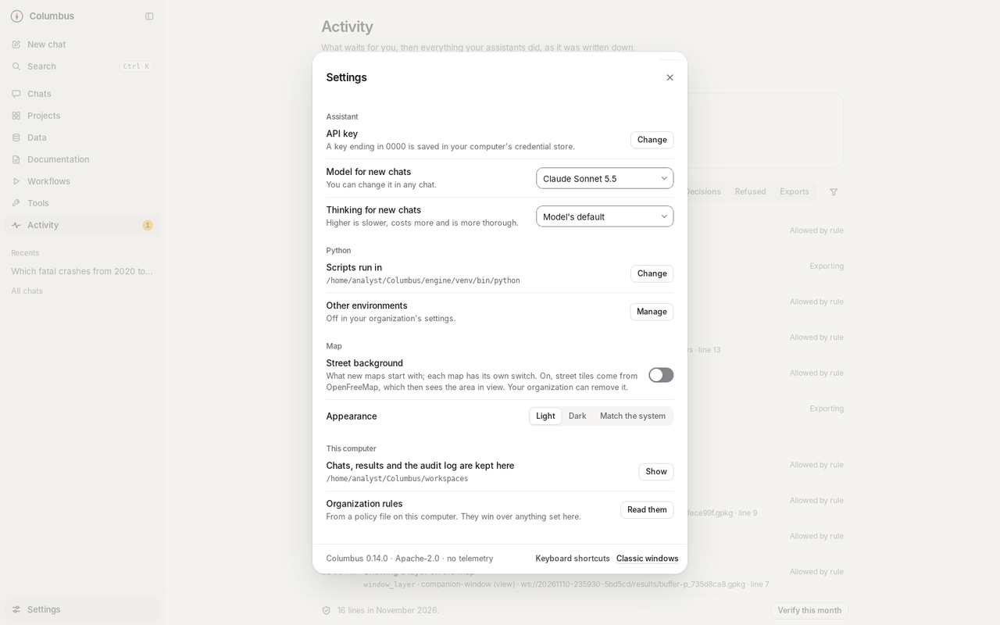

  

<h1 align="center">Columbus</h1>

  <b>A governed GIS workbench for working with AI.</b> 
  Your assistant reads, checks and maps your data under your organization's rules, and nothing changes or leaves your computer without you.

  
  
  
  
  

  <a href="https://github.com/wiatrek-kevin-s/columbus/releases/latest"><b>Download</b></a> ·
  <a href="docs/install-macos.md">Install on a Mac</a> ·
  <a href="docs/install.md">Install on Windows</a> ·
  <a href="docs/reference.md">Technical reference</a>

   
  A chat in the Columbus app. The assistant read two layers, looked at them on a map to check that they line up, and answered. The map, the layers and their checks are beside the chat.

> [!WARNING]
> **Test releases.** Columbus is young software, built mostly by an AI model (see [Disclaimer](#disclaimer)). Try it on data you can afford to have read, and have your organization review it before using it on production or sensitive data.

## Why Columbus

- **Your AI, your data, your rules.** Use Columbus from Claude desktop or any other AI app that speaks MCP, or from its own chat with your Anthropic API key. Whatever the AI asks for, Columbus decides in its own code (not in a prompt) what it may read and do.
- **Read-only by default.** Every connection is read-only until your organization's settings allow edits, and even then each change set is shown to you before anything is written.
- **Nothing leaves or changes without you.** Exports, edits, scripts and downloads wait for your yes. Approvals are bound to the exact request, single-use, and expire.
- **Every result is checked.** Row counts, CRS and units, geometry validity, row limits and filters come back with every result as checks: passed, to review, or failed. A failed check blocks exports until you decide.
- **It shows its work.** Every output has a provenance record (inputs, steps, checks), and every call, including refusals, is a line in a hash-chained audit log on your computer.
- **Local and private.** Columbus runs on your computer. Your data goes to the AI service you chose, and only the rows the rules let it see. Columbus itself sends nothing anywhere: no telemetry, no account.

## A tour

<table>
  <tr>
    <td width="50%"> <b>Chat</b>: the assistant's steps fold into short lines with check badges; the map and table sit beside it.</td>
    <td width="50%"> <b>Map first</b>: one click puts the map in the middle and the chat on the side, for reviewing results.</td>
  </tr>
  <tr>
    <td> <b>Approvals</b>: an export to a folder that isn't pre-approved waits for you, with exactly what it will write and where.</td>
    <td> <b>Home</b>: what needs you, from every chat and AI app on this computer: requests, notes in draft, tools and workflows to review.</td>
  </tr>
  <tr>
    <td> <b>Workflows</b>: a job your assistant proposed, in plain words and in full, approved once with Touch ID or Windows Hello.</td>
    <td> <b>Workflow runs</b>: each run's report: steps, row counts, checks and what was exported.</td>
  </tr>
  <tr>
    <td> <b>Your own tools</b>: a script your assistant packaged as a tool, read line by line before you install it.</td>
    <td> <b>Connections</b>: your databases and files, and in plain words what the assistant may see in each.</td>
  </tr>
  <tr>
    <td> <b>Audit log</b>: every call any assistant made through Columbus, and every decision, with a check of the chain.</td>
    <td> <b>Settings</b>: the AI for chats (model and thinking level), the server and engine in use, and your organization's switches.</td>
  </tr>
</table>

Every screenshot is taken from the app itself by a script ([`app/desktop/e2e/screenshots.py`](app/desktop/e2e/screenshots.py)), on made-up data around Austin, Texas.

## The app, page by page

The Columbus app is one window with a menu down the side.

| Page | What it is for |
| --- | --- |
| **Home** | What needs you right now: requests waiting for a decision, notes in draft, tools and workflows to review, recent chats. The first time, a short setup checklist (connect an AI, set up the GIS engine, add a connection). |
| **Chats** | Your conversations in the app, saved and searchable (**Ctrl+K** / **⌘K**), and the sessions other AI apps (Claude desktop) run through Columbus, with what they did and their map. A chat opens with the map and table beside it; choose its model and thinking level below the message box. |
| **Projects** | A piece of work with its own instructions for the assistant, the connections its chats may use, a default export folder and its project databases. |
| **Documents** | Notes Columbus drafted from your databases (fields, codes, relationships), which you fill in and **Mark reviewed**, and your organization's context pack, read only. |
| **Data groups** | Named sets of datasets across connections, each with an optional row filter; attached to a project, its chats see only those rows. |
| **Skills** | The GIS skills your assistant reads: when to use which tool, and how. Skills are advice; they never grant access. |
| **Connections** | Add, test and edit GeoPackages, SQLite files, shapefiles, file geodatabases, raster folders, folders of files (CSV, Excel, GeoJSON, GeoParquet, KML, FlatGeobuf), ArcGIS Online and Portal services (with **Sign in**) and databases (PostGIS, Oracle, SQL Server), each with its mode (read-only or read-write), allowed datasets, row filter and limits. Anything that gives the assistant more access asks for Touch ID or Windows Hello. **Draft notes** writes a note about a connection's datasets for you to review. **Map layers** adds imagery and other web services to your map (display only; the assistant never sees them). |
| **Registry** | The open geospatial registry: open data by place and theme, and GIS tools, searched through Columbus. |
| **Tools** | Tools your assistant made from its scripts. You read each one, code and all, and install it; installed tools run without asking, in the same sandbox as scripts. |
| **Workflows** | Jobs that run by themselves on a schedule: proposed by your assistant, approved by you, with **Run now**, **Pause**, and every run's report. Optionally an AI review of the results against your criteria. |
| **Activity** | The **approvals inbox** across every session, the **audit log** (filter by app, tool and decision; verify the chain), and **exports**. |
| **Settings** | The AI for chats (API key, model, thinking level), the Columbus server and GIS engine in use, your Python environments, theme, privacy, keyboard, and your organization's settings in plain sentences. |

## What it can do

| Area | Highlights |
| --- | --- |
| **Data** | GeoPackage, SQLite, shapefiles, file geodatabases, raster folders, folders of CSV, Excel, GeoJSON, GeoParquet, KML and FlatGeobuf files, ArcGIS Online/Portal layers (public or signed in); PostGIS, Oracle and SQL Server (read-only, or read-write when allowed); datasets allowed by name or pattern; row filters and hidden fields applied in the server; limits on rows and time. |
| **Analysis** | `query_features`, checked SQL (`sql_select`), vector operations (reproject, buffer, simplify, make valid, clip, dissolve, intersect, attribute and spatial joins), raster operations, verification checks; results are workspace layers passed by handle, never pasted into the chat. |
| **Looking** | The map and table beside each chat; `map_snapshot` lets the assistant look at its layers as a picture (geometry only, no basemap, nothing downloaded) to spot slivers, gaps and layers that don't line up. |
| **Big tables** | Raised limits (up to 20 million rows per query, by your organization), results streamed to disk, and project databases (DuckDB) to load several tables into and join with SQL. |
| **Approvals** | Exports, edits, scripts, downloads and sending data to connected servers wait for you: in your AI app's own prompt, in the Columbus app's chat, or on a local approvals page. Bound to the exact request, single-use, expiring. |
| **Your tools** | Save a script as a tool (`propose_tool`): checked, test-run in the sandbox, read and installed by you, then reusable by any assistant. |
| **Workflows** | Save a job as a workflow (`propose_workflow`): reading and checking steps, the connections it may read, a schedule (launchd on macOS, Task Scheduler on Windows), results to an export folder, an optional AI review. Never waits for you: anything that needs approval stops it with "needs you". |
| **Connected servers** | Other MCP servers (Drive, notes, vendor APIs) behind Columbus, reviewed and pinned by manifest, confined, with data-flow rules on what may be sent where. |
| **Context** | Your organization's context pack (datasets, domains, LRS, SOPs, delivery specs) and your own notes, searchable by the assistant. |
| **Audit** | One hash-chained line per call, including refusals; `columbus-mcp audit verify`; the app's viewer. |
| **Platforms** | macOS 15 or later (Apple Silicon) and Windows 10/11. The server also builds and runs on Linux. |

## Get Columbus

Download from the [latest release](https://github.com/wiatrek-kevin-s/columbus/releases/latest):

- **Mac (Apple Silicon, macOS 15 or later):** the Claude extension (`.mcpb`), the Columbus app (`.dmg`), and, the first time, the server folder (`.zip`) to set up the GIS engine. Follow the [Mac install guide](docs/install-macos.md).
- **Windows 10 and 11:** the Claude extension (`.mcpb`), the Columbus app (`-setup.exe`, or `.msi` for IT), and, the first time, the server folder (`.zip`). Follow the [Windows install guide](docs/install.md).

The release notes on each release have the exact files and update steps. The app is not code-signed yet, so macOS and Windows warn the first time; the guides say what to do.

## Quick start

1. **Set up the GIS engine** once, from the server folder: `engine/setup-engine.sh` (Mac) or `engine\setup-engine.ps1` (Windows).
2. **Connect an AI.** Either install the `.mcpb` extension in Claude desktop, or open the Columbus app and add your Anthropic API key under **Settings › Models and accounts**.
3. **Add a connection** in the app (**Connections › Add connection**): a GeoPackage is the quickest start.
4. **Ask.** For example:
   - *Which datasets can I use, and what CRS are they in?*
   - *Check the parcels layer for invalid or empty geometries and show me where they are.*
   - *Make what we just did a workflow that runs every weekday at 6.*

From the command line, `columbus-mcp --version` prints the server's version, `columbus-mcp workflow list` lists your workflows, and `columbus-mcp audit verify <file>` checks an audit log. See the [technical reference](docs/reference.md#build-and-run) to build from source.

## How it is built

| Part | Folder | Job |
| --- | --- | --- |
| **Gateway** (`columbus-mcp`) | [`crates/gateway`](crates/gateway) | The MCP server: tools, policy, approvals, audit, provenance, the approvals page, the workflow runner |
| **Shared rules** | [`crates/shared`](crates/shared) | Policy, access, SQL checking, approvals, audit chain, personal tools and workflows on disk |
| **Broker and flows** | [`crates/broker`](crates/broker), [`crates/flow`](crates/flow) | Connected MCP servers, their manifests, and data-flow rules |
| **Sandbox** | [`crates/confine`](crates/confine) | Confinement for scripts, tools and connected servers (Seatbelt on macOS, AppContainer and job objects on Windows, Landlock and seccomp on Linux) |
| **Chat** | [`crates/chat`](crates/chat) | The app's own chat with the Anthropic API |
| **GIS engine** | [`workers/python`](workers/python) | geopandas, pyogrio, shapely, pyproj, rasterio and DuckDB, as a worker the gateway drives |
| **Desktop app** | [`app/desktop`](app/desktop) | Tauri 2 (Rust) with a plain HTML/JS interface |
| **Map page** | [`app/ui`](app/ui) | MapLibre map and table, served by the gateway, shown beside each chat |
| **Skills** | [`skills`](skills) | GIS skills for assistants, checked against the server's tool names |

The rules live in the gateway; the app adds no rules of its own. The [technical reference](docs/reference.md) has the details: what is enforced and how, confinement levels, connected servers, the context pack, tests and honest limits.

## Disclaimer

Columbus is built primarily by **Claude, an AI model made by Anthropic**, working under the direction of its owner, a GIS analyst rather than a software engineer. Its design, code, tests and documentation were written largely by AI, and its security relies on automated tests (on macOS, Windows and Linux) and on independent AI security reviews of each change, **not on a professional human security audit**.

It is offered as test releases, as is, without warranty (see the [license](LICENSE)). Do not rely on it to protect sensitive data, or use it on production systems, until your organization has reviewed it. AI assistants that use Columbus can make mistakes; check their results, which is what Columbus's checks, provenance and approvals are there to help you do.

## License

[Apache License 2.0](LICENSE).
