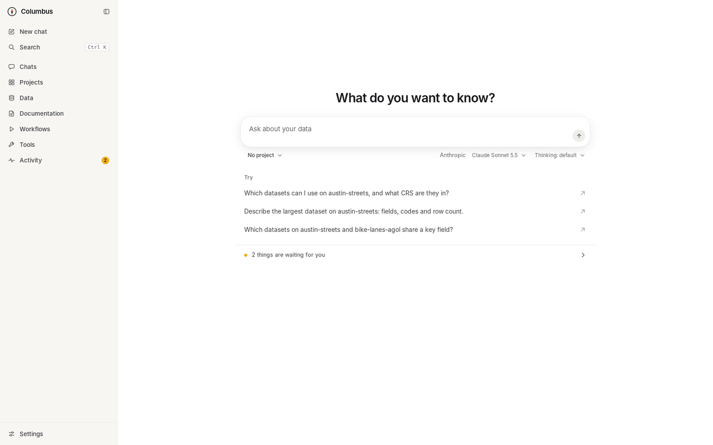
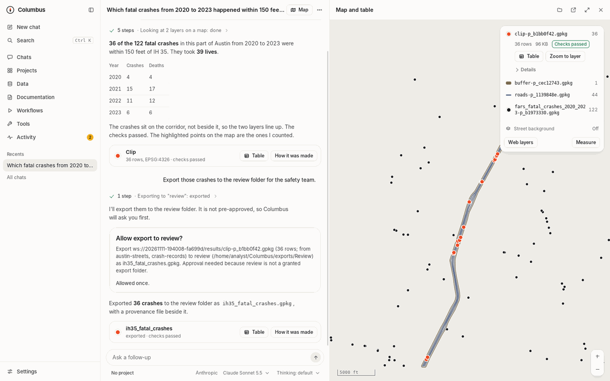
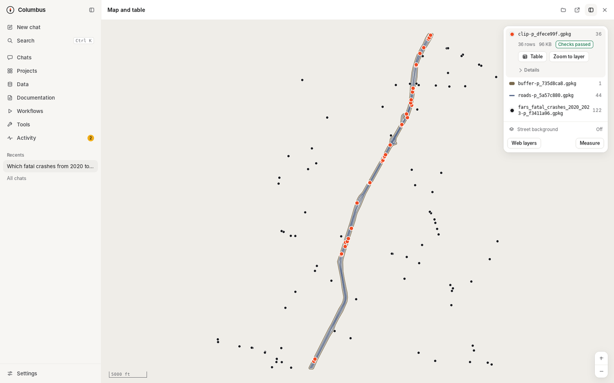
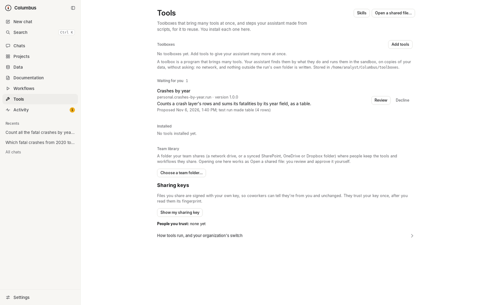
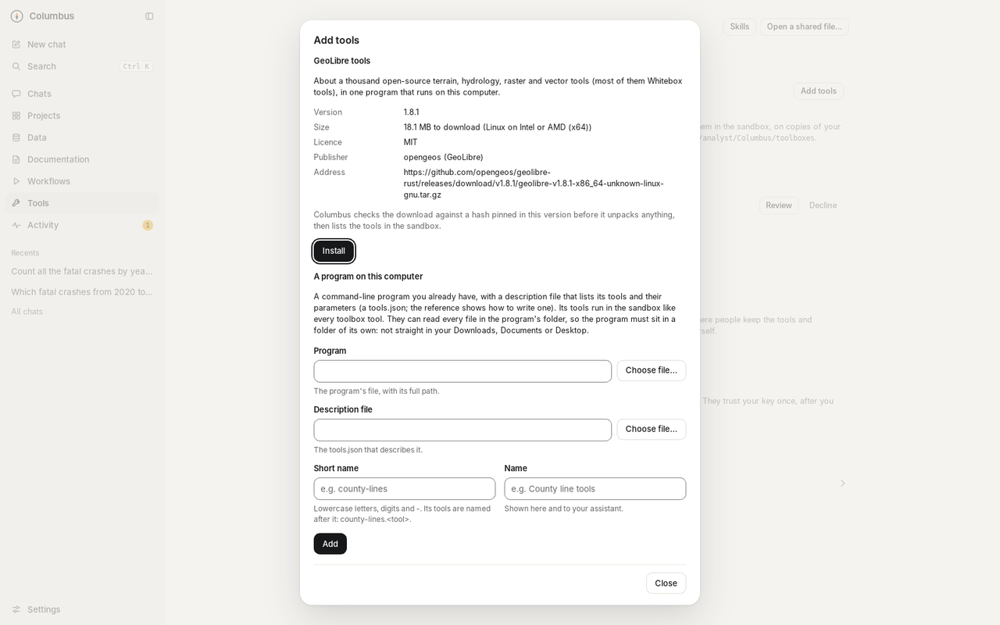
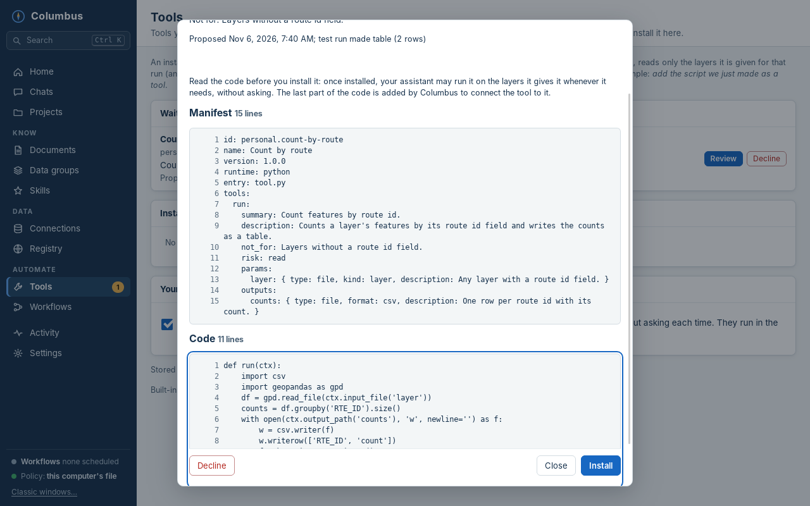
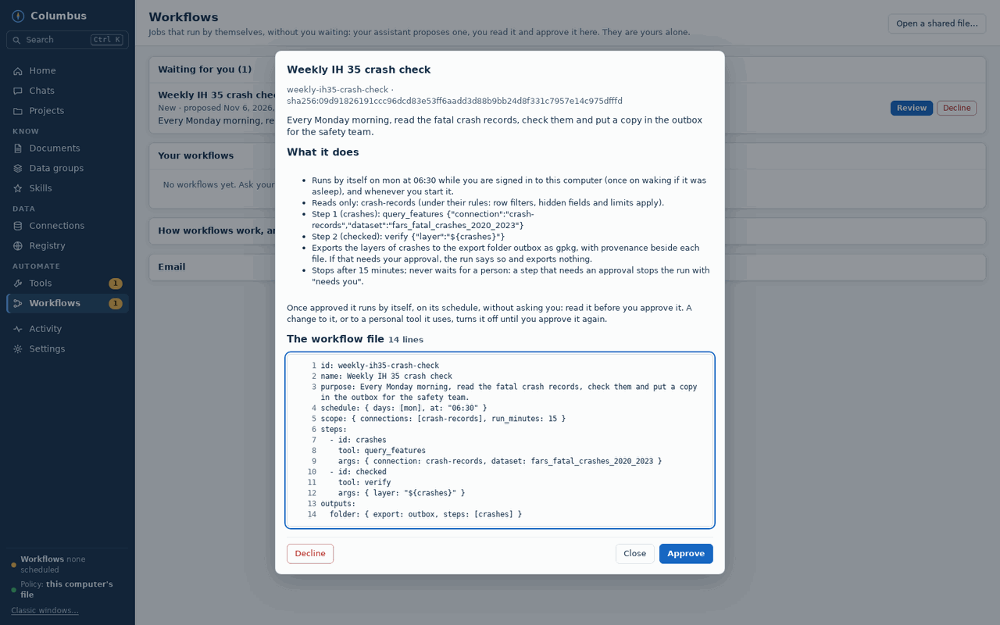
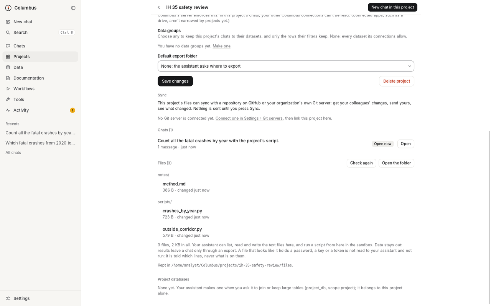
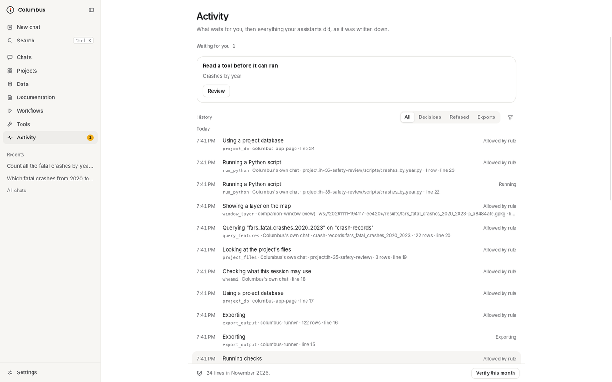
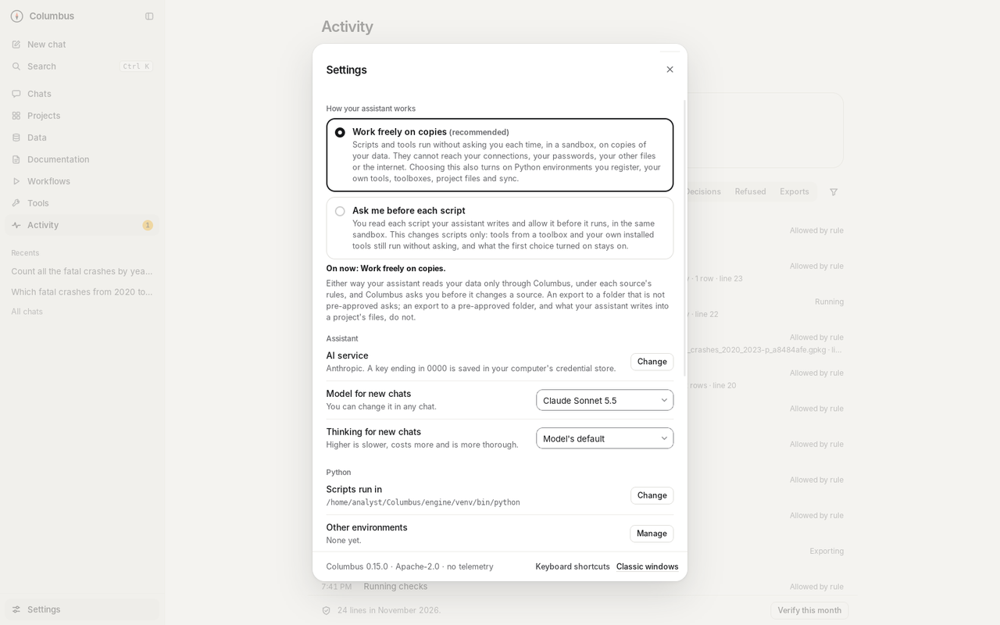

# The Columbus app, page by page

What each page of the Columbus desktop app (0.15.0) is for. For how it works underneath, see the [technical reference](reference.md#companion-window-and-desktop-app); to install it, the [Mac](install-macos.md) or [Windows](install.md) guide.

The Columbus app is one window with three parts. On the left is a sidebar. In the middle is the chat, or the page of the place you chose. On the right, a panel opens when your assistant makes something: the chat's map and table.

The app opens on a question in the middle of the window (*What do you want to know?*): a box to ask in, with the chat's project, AI service, model and thinking level under it, things to try, and a line when something waits for you. Once you ask, the chat takes the middle column, with its title at the top. The first time, in place of the question, it says **Start with your data** (**Add data**), with two checks under it: connect an AI for the chat (choose the AI service from a list, and save its key where it takes one; a model on your own computer through Ollama takes none), and the GIS engine. Each can be skipped, and **Skip setup** skips them all. Under the checks it asks **How should your assistant work?**: **Work freely on copies** (recommended) or **Ask me before each script**. The same choice is at the top of **Settings**, described below.

The sidebar has, from the top: the Columbus name, with a button that folds the sidebar to a rail of icons and back (your choice is remembered); **New chat** and **Search** (**Ctrl+K**, or **⌘K** on a Mac: chats by title and content, sessions, every page, and your connections, workflows and projects by name); seven places, **Chats**, **Projects**, **Data**, **Documentation**, **Workflows**, **Tools** and **Activity** (which shows a count when something waits for you); **Recents**, your most recent chats and the sessions other AI apps run (a dot marks one that waits for you), with **All chats** under them; and at the bottom, **Settings**.

| Where | What it is for |
| --- | --- |
| **Chats** | The list of your chats, saved on this computer: a search box, **New chat**, and the chats grouped by day (Today, Yesterday, This week, Earlier). Sessions that other AI apps (Claude desktop, for example) run through Columbus are in the same list, and open to show what they did and their map. The footer chooses which project's chats show. |
| **A chat** | The conversation in the middle column, with its title at the top. The assistant's steps fold into one line ("3 steps · …") that opens to show each step. The last result of a turn is a card with **Table** (opens that result's rows on the map) and **How it was made** (its checks, inputs and files); both open in the panel on the right. A request for your approval is a card in the chat (**Columbus needs your OK**), with **Allow once**, **Allow for this chat** where Columbus offers it, and **Decline**. Columbus asks when something would leave the workspace (an export to a folder that isn't pre-approved, a download from a host not on the list), change a source, or run outside the sandbox; under **Ask me before each script** it also asks before each script. Under the message box: the chat's project (you can choose it until the first message), its AI service, the model and, where the service has them, the thinking level. A chat keeps its service to its end; you can change its model. Beside the title, **Map** opens and closes the panel on the right, and the **⋯** menu has **Files this chat made**, **Fill the window with the map**, **Open the map in its own window** and **New chat**. |
| **The panel on the right** | What your assistant made, beside the chat. It opens by itself the first time your assistant makes a result in a chat; if you close it, it stays closed until you open it with **Map**, or press **Table** on a result card. Its head says **Map and table** and has four buttons: the chat's files, the map in its own window, **Fill the window** (the chat is put away and the panel has the window; the same button brings the chat back) and close. It shows the chat's map, with its legend at the top right and the table as a sheet on the map. Things to read open in the same panel, over the map, each with its own title and a close button: **How it was made**, the chat's files, a note. Drag the edge between the chat and the panel to resize it, or move it with the arrow keys when it has the focus; the width is remembered. In a window narrower than 1100 px the panel lies over the chat instead of beside it. When Columbus needs your OK while the map fills the window, the chat comes back by itself. Your assistant can read what this map shows (the area, the layers that are on, the feature you selected) and point it at a result: it turns layers on or zooms, the panel opens if it was closed, and a line says **Your assistant changed what the map shows.** |
| **Projects** | A piece of work with its own instructions for the assistant, the connections and data groups its chats may use, and a default export folder. A project's page also has **New chat in this project**, its chats, its project databases, and two sections. **Files**: the project's own folder of scripts and notes, each file with its size and when it changed. **Open the folder** shows it in Explorer or Finder, so you can put your own scripts in; your assistant can read and write the text files there and run a script from there. **Sync**: **Link this project** to a repository on a Git server you connected in **Settings**, then **Check for changes** (only reads) and **Sync** (gets the server's changes, then sends yours, with your note). A file changed on both sides is kept twice and listed under **Needs a look**, with **Keep mine**, **Keep theirs** and **Keep both**. **History** lists the latest changes; **Disconnect** forgets the link and leaves the files alone. |
| **Data** | What your assistant can reach, one row per connection: what it is, read only or read and write, and the rule that matters. Under it, where results can go (your organization's export folders). **Add data** opens the connection editor for GeoPackages, SQLite files, shapefiles, file geodatabases, raster folders, folders of files (CSV, Excel, GeoJSON, GeoParquet, KML, FlatGeobuf), ArcGIS Online and Portal services, and databases (PostGIS, Oracle, SQL Server), with its allowed datasets and row filter; **Test** it before you **Save**. Anything that gives the assistant more access asks for Touch ID or Windows Hello. |
| **A connection's page** | Click a connection's row under **Data**. Its rules in plain words ("Your assistant can read it, and change nothing."): read only or read and write, which datasets, which rows, sign-in. **Change the rules** edits them, **Test** opens it as Columbus would, **Draft notes** writes a note about its datasets for you to review, and **Sign in** signs in to ArcGIS. Its datasets with notes are listed there. |
| **Data › Datasets** | The datasets Columbus knows for each connection, from your notes. |
| **Data › Data groups** | Named sets of datasets across connections, each with an optional row filter; attached to a project, its chats see only those rows. |
| **Data › Map layers** | Imagery and other web services for your map (display only; the assistant never sees them). |
| **Data › Project databases** | The project database files in your workspaces folder. |
| **Data › Registry** | The open geospatial registry: open data by place and theme, and GIS tools, searched through Columbus. |
| **Documentation** | What your assistant reads to understand your data. The line at the bottom of **Data** opens it too. **My notes**: notes Columbus drafted from your databases (fields, codes, relationships), which you fill in and **Mark reviewed**. **Organization's pack**: your organization's context pack, read only. **Proposals**: notes that no longer match their database or are due for review, and changes your assistant suggested. **Import**: a document becomes a draft note. A note opens to read in the panel on the right. |
| **Workflows** | Jobs that run by themselves on a schedule: proposed by your assistant, approved by you. The page lists what can't run until you read it (proposed workflows and tools, with **Review** and **Decline**), what runs by itself (scheduled workflows) and what runs when you ask (other workflows, and installed tools). **Open a shared one** opens a file a coworker shared. A workflow's own page says when it runs, and has **Run now**, a **⋯** menu (pause or resume its schedule, **Share…**, **Remove**) and its runs. A run's report is its own page, with **Open in a chat**. Optionally an AI review of the results against your criteria; it uses Anthropic, with the Anthropic key, whichever AI service your chats use. |
| **Tools** | First, **Toolboxes**: programs that bring many tools at once. **Add tools** offers **GeoLibre tools** (about a thousand open-source terrain, hydrology, raster and vector tools) with its version, size, licence, publisher and download address, and **Install**, which asks for Touch ID or Windows Hello; or **A program on this computer**, added with a description file. Nothing is downloaded before you press **Install**, and the download is checked against a hash pinned in Columbus. A search box finds a tool by what it does (slope, buffer, clip), and a row opens what it does and its parameters in the panel on the right. **Remove** takes a toolbox away. Under them, tools your assistant made from its scripts: you read each one, code and all, and install it. Toolbox tools and installed tools run without asking, in the same sandbox as scripts, on copies. **Workflows** links here too. |
| **Tools › Skills** | The GIS skills your assistant reads: when to use which tool, and how. Skills are advice; they never grant access. |
| **Activity** | One page. On top, **Waiting for you**: requests from the app's own chat (**Answer in the chat**), requests from other AI apps (listed only, with **Decide in browser**), and workflows and tools to read. Under it, **History**: the audit log, newest first, in plain words with the line as written under it; quick views (**All**, **Decisions**, **Refused**, **Exports**); a filter for month, app, tool, decision and text; and **Verify this month**, which checks the chain. |
| **Settings** | One sheet over the page that is open. Its first view starts with **How your assistant works**: **Work freely on copies** (scripts and tools run without asking you each time, in a sandbox, on copies of your data; they cannot reach your connections, your passwords, your other files or the internet) or **Ask me before each script** (you read each script and allow it before it runs, in the same sandbox), with the one that is on now. Choosing the first asks for Touch ID or Windows Hello once. Either way Columbus asks before it changes a source and before an export to a folder that is not pre-approved; an export to a pre-approved folder, and what your assistant writes into a project's files, do not ask. Then: the assistant (the AI service and whether its key is saved; the model and thinking level for new chats), Python (where scripts run; other environments), the map (**Street background**; appearance: light, dark or match the system), this computer (where things are kept; your organization's rules) and sync (your Git servers). Parts that open inside it: **Assistant** (the row below), **Python environments**, **Privacy and files**, **Keyboard shortcuts**, **Git servers** (connect GitHub, a GitHub Enterprise Server, a Gitea or a Forgejo with a token, which goes into your computer's credential store; **Remove** deletes it) and **Organization rules** (the policy in force, in plain sentences, and its switches). The foot has the version and **Classic windows** (the earlier session list and settings window, still kept). |
| **Settings › Assistant** | The AI your chats use. **Service for new chats** lists Anthropic, OpenAI, xAI (Grok), Google Gemini and OpenRouter, and two that run on your own computer, Ollama and LM Studio. Under it: where that service's key comes from; the key box, with **Save key** and **Remove key** (a key goes into your computer's credential store, and the app can never read it back); the model for new chats, from a short list, from **Load the list from the service**, or typed as **Another model's id**; the thinking level, where the service has one; and the GIS engine. **Other services** has **Add another service**: a name, its address, one of three request formats and how its key is sent (for Azure OpenAI, Mistral, DeepSeek, Groq, Together, Amazon Bedrock or your organization's own gateway). Adding one asks for Touch ID or Windows Hello, because it changes where your chat is sent. **Use Columbus from another AI app** shows, for the app you choose (Claude desktop, GitHub Copilot in VS Code, the Copilot CLI, Visual Studio, JetBrains IDEs, Cursor, Codex and ChatGPT desktop, Gemini CLI, Claude Code, LM Studio), the file to change and the exact entry for this computer, with **Copy the entry**. Whatever service you choose, what your assistant reads is sent to it. Every service except Anthropic is untried on the real thing ([manual checks](manual-checks.md), H-6). |

## From the command line

The same server runs without the app. A few commands people use most:

| Command | What it does |
| --- | --- |
| `columbus-mcp --version` | Prints the server's version |
| `columbus-mcp secret set <id>` | Stores a connection's database password in the operating system's credential store |
| `columbus-mcp arcgis signin <id>` | Signs in to an ArcGIS connection (`--paste-code` to paste a code instead); `arcgis signout <id>` removes it |
| `columbus-mcp env add <id> --python <path>` | Registers a Python environment (`--trust trusted` for a trusted one, experimental); `env list`, `env confirm <id>`, `env remove <id>` |
| `columbus-mcp env proposals`, `env approve <id>` | Environments your assistant asked for, and approving one |
| `columbus-mcp workflow list`, `workflow run <id>` | Your workflows, and running one now |
| `columbus-mcp workflow open <id> <run>` | Opens a finished run's results in a new session for another AI app |
| `columbus-mcp toolbox install geolibre` | Installs the GeoLibre toolbox from Columbus's catalogue: shows what it is, asks, downloads, checks the hash, lists its tools |
| `columbus-mcp toolbox list`, `toolbox tools <words>`, `toolbox remove <id>` | Your toolboxes and what the catalogue offers; finding a tool by words; removing a toolbox |
| `columbus-mcp map-source list` | Your web map layers |
| `columbus-mcp audit verify <file>` | Checks an audit log's hash chain |

Every command is in the [technical reference](reference.md).

## Pictures

Taken from the app by [`screenshots.py`](../app/desktop/e2e/screenshots.py), on [public data for central Austin](images/DATA-CREDITS.md).

<table>
  <tr>
    <td width="50%"> <b>The start</b>: the question first.</td>
    <td width="50%"> <b>The first run</b>: your data, an AI for the chat, then how your assistant should work.</td>
  </tr>
  <tr>
    <td> <b>A chat</b>: steps and answer in the middle, the map on the right.</td>
    <td> <b>Fill the window with the map</b>: the chat put away, for reviewing.</td>
  </tr>
  <tr>
    <td> <b>Tools</b>: toolboxes first, then tools made from your assistant's scripts.</td>
    <td> <b>Add tools</b>: what would be installed, before anything is downloaded.</td>
  </tr>
  <tr>
    <td> <b>A proposed tool</b>: read line by line before installing.</td>
    <td> <b>Workflows</b>: a proposal, read before it is approved.</td>
  </tr>
  <tr>
    <td> <b>A project</b>: sync, its chats and its files.</td>
    <td> <b>Activity</b>: what waits for you, then every call and every decision.</td>
  </tr>
  <tr>
    <td> <b>Settings</b>: one sheet, over the page that is open.</td>
    <td> <b>Settings › Assistant</b>: the AI service for new chats, its key and its model.</td>
  </tr>
</table>
